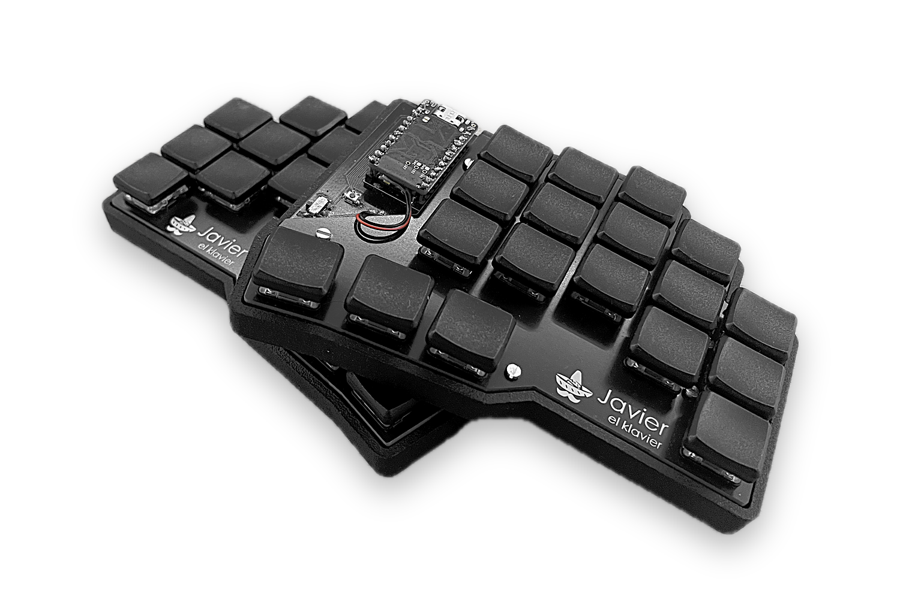
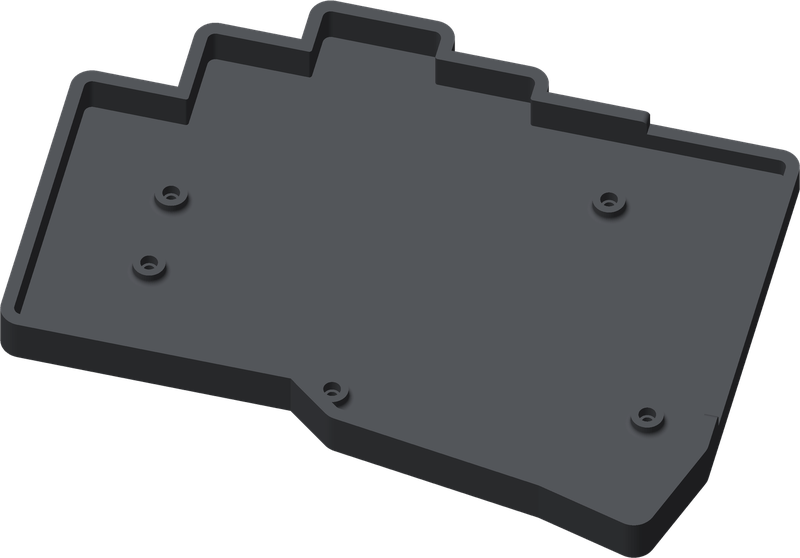
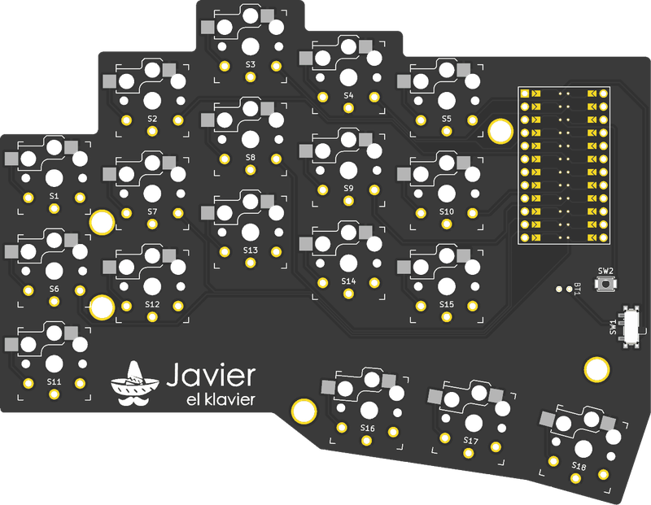
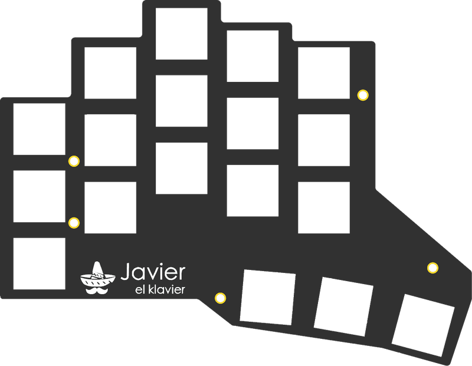

  <picture>
    <source media="(prefers-color-scheme: dark)" srcset="docs/images/logo-dark.svg">
    
  </picture>

Javier is a 36-key wireless split keyboard. It uses Kailh Choc v1 switches in hot-swap sockets, nice!nano v2 controllers and [ZMK](https://zmk.dev). Both hands use the same PCB and plate.

  <picture>
    <source media="(prefers-color-scheme: dark)" srcset="docs/images/hero-dark.png">
    
  </picture>

## Features

- **Wireless.** Each half has its own nice!nano v2 and battery. The halves connect to each other and to the computer over Bluetooth, with no cables.
- **Hotswappable.** Every switch can sit in a Kailh Choc socket, so you can change switches without solder. The sockets are optional: you can also solder the switches directly to the PCB.
- **Diodeless.** Each key connects directly to its own controller pin, so there is no diode matrix. There are fewer parts to solder and fewer joints that can fail.
- **Reversible PCB.** The left and right halves use the same PCB and the same plate. You order one design and turn it over for the other hand.

## Build

  
  &nbsp;&nbsp;&nbsp;
  
  &nbsp;&nbsp;&nbsp;
  

<em>Case, PCB and plate</em>

Follow the [build guide](docs/build-guide.md).

## Firmware

The firmware builds with GitHub Actions on every push. The included keymap is a plain QWERTY starting point.

1. Fork this repository and enable Actions.
2. Edit [`javier.keymap`](config/boards/shields/javier/javier.keymap) and push.
3. Download the `firmware` artifact from the workflow run.

To learn how it works, see the [ZMK documentation](https://zmk.dev/docs) and its [keymap guide](https://zmk.dev/docs/keymaps).

## Files

| Path | Contents |
|------|----------|
| `hardware/production/` | Gerber files for the PCB and plate |
| `hardware/case/` | Printable left and right cases |
| `hardware/pcb/`, `hardware/plate/` | KiCad projects |
| [`docs/schematic.pdf`](docs/schematic.pdf) | Schematic |
| `config/` | ZMK configuration |

## Credits

Javier is inspired by these open-source keyboards:

- [Corne](https://github.com/foostan/crkbd) by foostan
- [Cantor](https://github.com/diepala/cantor) by Diego Palacios

## License

Firmware configuration: [MIT](LICENSE). Hardware: [CC BY-SA 4.0](hardware/LICENSE). See [third-party notices](THIRD_PARTY.md).
