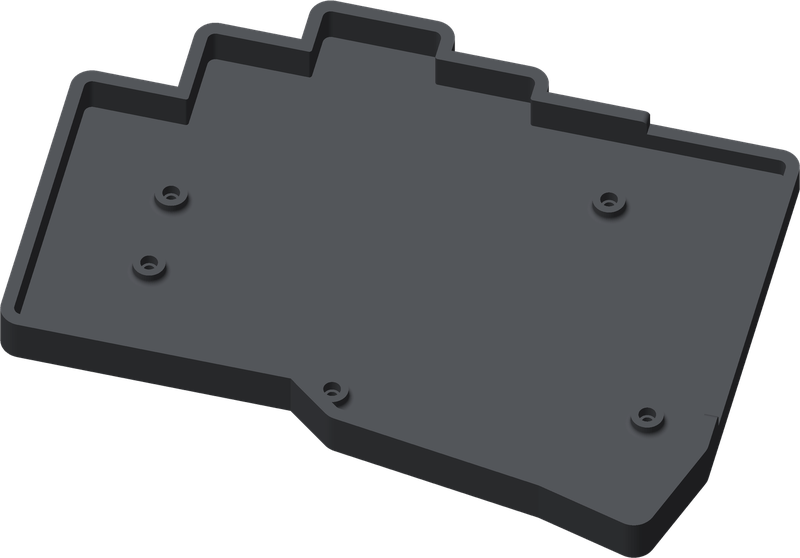
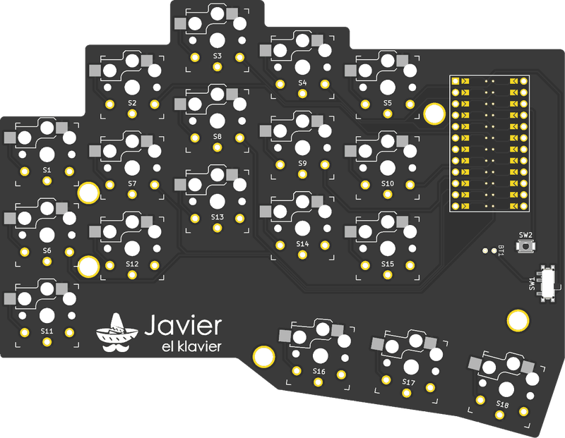
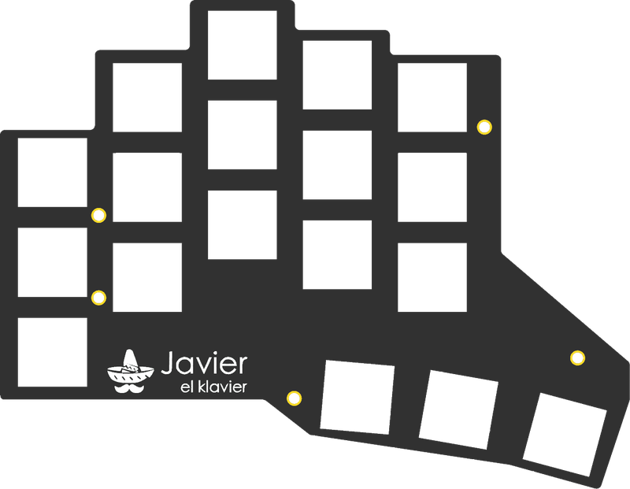
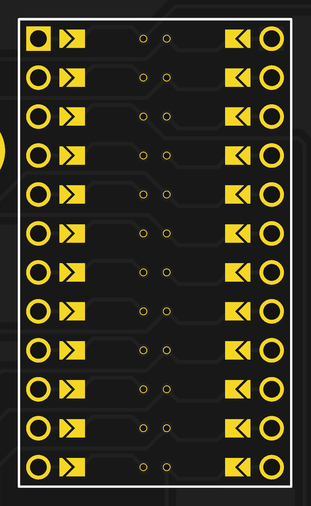

# Build guide

## Parts

  
  &nbsp;&nbsp;&nbsp;
  
  &nbsp;&nbsp;&nbsp;
  

<em>Case, PCB and plate</em>

| Part | Qty |
|------|-----|
| PCB ([Gerbers](../hardware/production/javier-pcb-gerbers.zip), 1.6 mm thick) | 2 |
| Plate ([Gerbers](../hardware/production/javier-plate-gerbers.zip), 1.2 mm thick) | 2 |
| Printed case ([left](../hardware/case/case-left.3mf), [right](../hardware/case/case-right.3mf)) | 1 each |
| nice!nano v2 | 2 |
| Kailh Choc v1 switch | 36 |
| Kailh Choc hot-swap socket | 36 |
| Choc keycap | 36 |
| PCM12 slide switch | 2 |
| Omron B3U-1000P button | 2 |
| Single-cell LiPo battery, small enough to fit under the nice!nano | 2 |
| Header pins | 48 |
| M2 spacer, 6 mm long, up to 3.2 mm wide | 10 |
| M2 × 4 mm low-profile screw, head up to 5 mm wide | 20 |

## Left or right

The face you put on top decides the hand. Mark it before you start.

- **Left:** controller upper right, thumb keys lower right.
- **Right:** controller upper left, thumb keys lower left.

Everything goes on the top face except the sockets.

## Assembly

Do this for each half.

### 1. Bridge the controller jumpers

Mount the controller with its components facing the PCB, so bridge the 24 arrow-shaped jumpers on the **top** face.

If you want the components facing up instead, bridge the jumpers on the underside.

> [!CAUTION]
> Bridge one face only. Bridging both faces shorts `RAW`, `RST`, `VCC` and `GND` to other pins.

### 2. Solder the sockets

Solder one socket at each of the 18 key positions, on the **underside**.

### 3. Solder the switches

On the top face, solder the slide switch and the reset button:

- **Left half:** `SW1` and `SW2`
- **Right half:** `SW4` and `SW3`

### 4. Connect the battery

Solder the leads to the two `BT1` holes. **Positive goes to the hole nearest the reset button.** The battery sits between the controller and the PCB.

### 5. Flash the controller

Connect it over USB and double-tap reset. Copy its `.uf2` file to the `NICENANO` drive:

- `javier_left` for the left half
- `javier_right` for the right half

### 6. Solder the controller

Mount it on the top face with the USB port toward the board's top edge, on headers tall enough to clear the battery. Trim the pins flush on the underside, because there is only 2.5 mm of clearance to the case floor.

### 7. Assemble the case

Build it up from the bottom, in this order:

1. **Case:** fix the 5 spacers into the case pockets, with screws from under the case.
2. **PCB:** lower the PCB into the case, sockets facing down. The spacers pass through its holes.
3. **Plate:** place the plate on the spacers and screw it down from above.
4. **Switches:** push each switch into the plate **from the top** until it clips in. Its pins go through the PCB and into the socket underneath.
5. **Keycaps:** press a keycap onto each switch.

## Pairing

Switch both halves on, then select **Javier** in your computer's Bluetooth settings.

If the halves stop connecting, flash `settings_reset` to both, then flash `javier_left` and `javier_right` again.
